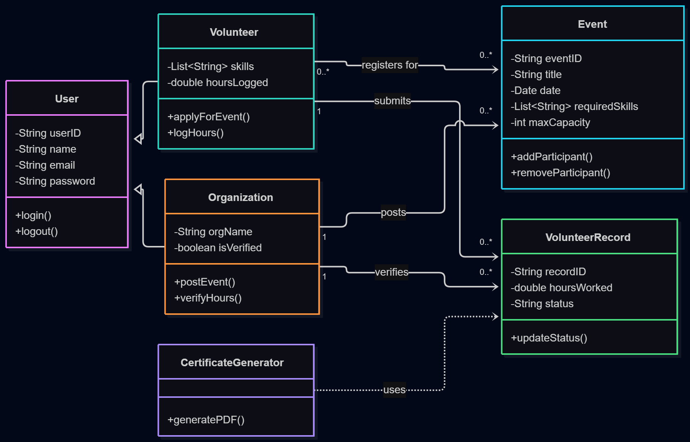

# CS3SY26_ProjectProposal by Group 10 of Potassium

## Project Proposal Template:
### Project Title or Name of the Application	: CommUnityMatch
### Section			   	      : 9 - Potassium
### Group Members			    : GARAIS, GARSUTA, SERRANO
### Date (Proposal Date)  : Nov 12, 2026

### Project Description:

CommUnityMatch is an object-oriented application designed to bridge the gap between local non-profit organizations and prospective volunteers. Non-profit organizations frequently struggle to find individuals with specialized skills required for community initiatives, while volunteers, particularly students, often face challenges finding verified service opportunities or maintaining accurate logs of their service hours. CommUnityMatch resolves these issues by automating skill-based matching, streamlining event administration, and providing a centralized system for tracking and verifying community service hours.

The system architecture relies on several interacting classes. Account management begins with the abstract User base class, which stores standard credentials including userID, name, email, and password, alongside core methods like login() and logout(). This class is extended by two specialized subclasses: Volunteer, which adds attributes for skills and hoursLogged along with methods like applyForEvent() and logHours(); and Organization, which includes orgName and isVerified attributes alongside methods like postEvent() and verifyHours().

Event scheduling and volunteer matching are driven by the Event and MatchingEngine classes. The Event class tracks event metadata, such as eventID, title, date, requiredSkills, maxCapacity, and status, and exposes methods like addParticipant() to manage attendee rosters. The MatchingEngine class evaluates a Volunteer's listed skills against an Event's requiredSkills using its findMatches() method, automatically alerting eligible users to open positions.   Hour tracking and verification are managed through VolunteerRecord and CertificateGenerator. When a Volunteer completes service at an event, calling logHours() generates a VolunteerRecord containing recordID, hoursWorked, dateSubmitted, and an initial approval status of Pending. The hosting Organization then calls verifyHours() to update the status to Approved, which increments the volunteer's overall hoursLogged total. Finally, the CertificateGenerator queries these approved records via its generatePDF() method to produce official service documentation for school or employment requirements.   

The primary user demographic consists of high school and college students seeking verified community service hours, alongside local residents interested in offering specific skills such as tutoring, web development, or event coordination. The secondary demographic includes local non-profit organizations, community centers, schools, and charitable groups seeking reliable volunteers to staff their events and initiatives.

### Goals:

One of our main primary long-term goals of this project is to, one day, foster a more connected and supportive community by systematically reducing barriers to volunteer participation and enhancing operational efficiency for local non-profit organizations. Over time, we aim to increase overall volunteer engagement among students and local residents, ensuring that charitable initiatives are fully staffed with individuals possessing the exact skill sets required. By establishing a centralized and reliable system for hour verification and certification, the project seeks to empower volunteers with verifiable service records for academic and career advancement while enabling non-profits to maximize their community impact through sustained engagement.

- Objective 1: Develop and deploy a secure user management module that allows volunteers to create profiles with skill tags and enables organizations to publish categorized volunteer events.
- Objective 2: Implement an automated matching algorithm within the MatchingEngine class to connect registered volunteers with relevant event opportunities based on skill alignment and availability.
- Objective 3: Build an integrated hour-tracking system and PDF certificate generator to enable organizations to review, verify, and export official volunteer service records.
